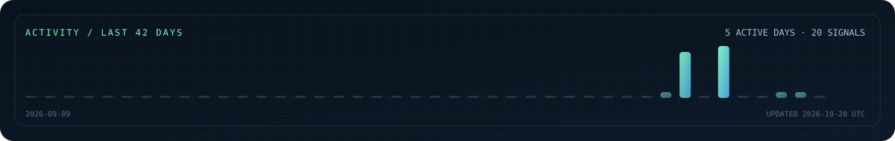

<div align="center">
  <a href="https://www.claudiodallara.it/">
    
  </a>
</div>

<div align="center">
  <a href="https://www.claudiodallara.it/"></a>
  <a href="https://www.linkedin.com/in/claudio-dall-ara-730aa0302/"></a>
  
</div>

<br />

## I build systems you can trust — and products people can use.

I'm a **DevOps & Observability Engineer at Agile Lab**, working with Kafka clusters and cloud-native platforms built on OpenShift, Jenkins, OpenTelemetry, Prometheus, Grafana and Jaeger.

Outside the day job, I ship full-stack products, educational platforms and Web3 experiments. In 2021 I turned 22 years of leadership experience into a deliberate engineering career: the domain changed, the instinct for ownership, systems and people did not.

```text
signal → context → decision → reliable system
```

<table>
  <tr>
    <td width="33%" valign="top"><b>⚙️ OPERATE</b><br/><br/>Resilient infrastructure, automation and CI/CD.<br/><br/><code>Linux</code> <code>Docker</code> <code>Kubernetes</code> <code>OpenShift</code> <code>Jenkins</code></td>
    <td width="33%" valign="top"><b>◉ OBSERVE</b><br/><br/>Telemetry that turns complex systems into clear signals.<br/><br/><code>Kafka</code> <code>OpenTelemetry</code> <code>Prometheus</code> <code>Grafana</code> <code>Jaeger</code></td>
    <td width="33%" valign="top"><b>↗ SHIP</b><br/><br/>Useful products from first idea to production.<br/><br/><code>React</code> <code>TypeScript</code> <code>Node.js</code> <code>Solidity</code> <code>AI</code></td>
  </tr>
</table>

## Selected signals

| Project | What it proves | Stack |
| :-- | :-- | :-- |
| **[Felis: Apex Hunter](https://www.claudiodallara.it/)** | Solo-built Android product: designed, shipped and marketed on Google Play, with no ads or accounts. | `React 19` `TypeScript` `Canvas` `PWA/TWA` |
| **[DevHarbor](https://github.com/boobaGreen/agileCourse)** | Production-grade, hands-on learning for Git, Docker and Kubernetes. | `React` `TypeScript` `Docker` `Kubernetes` |
| **[GiftBlitz](https://github.com/boobaGreen/GiftBlitzFull)** | Decentralized P2P gift-card marketplace built for the IOTA Hackathon. | `IOTA` `Solidity` `EVM` `Node.js` |
| **[Impara il C sul serio](https://github.com/boobaGreen/C-course---Salvatore-Sanfilippo)** | Interactive C learning with low-level simulations and content by Salvatore Sanfilippo. | `C` `WebAssembly` `React` `TypeScript` |
| **[Vim Mastery](https://github.com/boobaGreen/vim)** | A gamified, browser-based Vim course powered by WebAssembly. | `React 19` `Vite` `WASM` `Framer Motion` |
| **[LinuxQuest](https://github.com/boobaGreen/lpi_essential/tree/multi-course)** | Multi-certification training for Linux Essentials, LPIC and RHCSA. | `Linux` `React` `TypeScript` `Vite` |

> The common thread: learn deeply, make the invisible visible, then turn it into something useful.

## Engineering map

<div align="center">
  
  <br/><br/>
  
</div>

## Activity pulse

<div align="center">
  <a href="https://github.com/boobaGreen?tab=overview">
    
  </a>
</div>

<sub>The pulse is generated in this repository from GitHub's public events API and refreshed every day—no third-party stats renderer in the critical path.</sub>

## Now

- Keeping high-throughput Kafka and observability systems understandable and reliable at **Agile Lab**.
- Going deeper on Linux certifications, cloud-native operations and platform engineering.
- Shipping independent products and learning tools that make difficult technology approachable.

<div align="center">
  <br/>
  <b>Curious engineer. Systems thinker. Relentless builder.</b>
  <br/><br/>
  <a href="https://www.claudiodallara.it/">Explore the full journey →</a>
</div>
